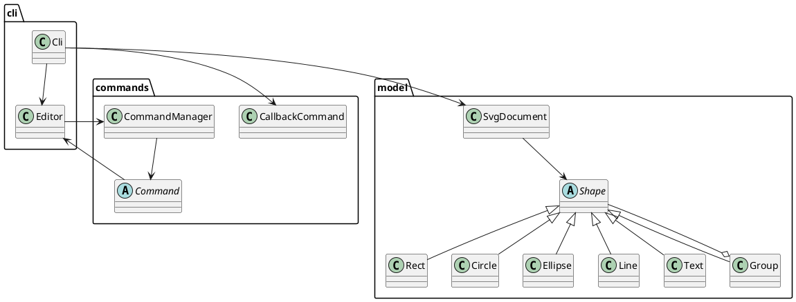

# SVG CLI 编辑器架构方案（第一版）

## 模块划分

| 目录 | 职责 |
|---|---|
| `src/cli`（当前 CLI 入口类暂在 `src/Cli.ts`） | 读取命令行、分词、校验命令参数并调用编辑器领域对象；负责文件读写入口 |
| `src/commands` | Command 接口/基类、具体命令对象与 undo/redo 历史 |
| `src/model` | SVG 文档、图形继承体系、容器树、SVG 解析和序列化 |
| `doc` | 架构、过程记录、一致性自查和质量说明 |

## 设计模式

- **Command**：`CallbackCommand` 将一次编辑封装为命令对象；`CommandManager` 管理 undo/redo。每次编辑前克隆文档作为撤销快照，失败时恢复快照；显示操作不入栈，init/read/save/canvas 操作重置历史并锁定 undo/redo，下一次编辑解除锁定。
- **Composite**：`Group` 与叶子 `Shape` 共享 `move`、`scale` 接口，容器把操作递归转发给子图形；文档通过根 Group 维护层级。
- **工厂/分发**：图形类型使用 `create` 中的类型分支创建，命令名使用 `Map` 注册分发。本版将其视为扩展点；若后续增加插件，替换为注册表/provider 插槽。

## 依赖方向

允许 CLI 层依赖 Editor、Command 与 Model；Command 层依赖 Editor/Model；Model 层只依赖 Model 内部与 XML 库。Model 不得依赖 CLI 或 Commands，避免领域对象反向耦合交互和历史实现。`Cli.ts` 目前承担 CLI 入口职责，目录实体暂未拆分，记为后续整理项。

## 变化点假设

1. 命令集合可能扩展：由 `Cli` 的命令 Map 增加注册项，后续可抽出命令注册模块；当前暂不引入插件注册机制。
2. 图形类型可能扩展：`Shape` 多态已提供统一操作；创建分支是唯一类型名分派处。插件阶段再抽 `ShapeProvider`，本阶段不实现 `box`。
3. SVG 格式/外部输入可能变化：解析和序列化集中于 `SvgDocument`，可独立替换解析器或扩展兼容策略。
4. 撤销粒度与性能可能变化：当前整文档快照实现简单可靠，文档较大时可改为命令自身保存逆操作或局部快照。

## 过程记录

- 根据说明将带标题矩形 `box` 留在后续插件阶段，本版仅支持 rect/circle/ellipse/line/text/g。
- 检查模型结构时发现容器注册与读回嵌套节点容易出现重复登记；将索引登记集中在文档 attach 操作，并让容器只维护子树关系。
- 命令编辑采用快照作为第一版撤销策略，命令失败时恢复快照，避免异常造成半更新状态。

## 一致性自查

- 模块边界与方案基本一致；CLI 目前是 `src/Cli.ts`，没有单独的 `src/cli` 目录，方案中已注明。
- Model 未依赖 CLI 或 Commands。CLI 使用命令对象及文档模型；Command 依赖 Editor 以回滚快照。
- 命令名到实现由 Map 分发；图形名到类由 `create` 的受限分支分派，符合文档列出的两处按名字分派约定。

## 质量保证手段

`npm test` 执行 TypeScript 严格类型构建；命令行可用 `npm run cli` 启动。第一版已通过严格构建，并回放 init/create/in、容器移动、文本属性修改、group/undo、根级 ungroup 拒绝、未知 box 类型、read/save round-trip 和 IO 后 undo 拒绝等典型会话。`git diff --check` 通过。当前未建立自动化集成测试；后续应补测缺失 id 自动分配、跨父级分组拒绝及更多外部 SVG 格式。
