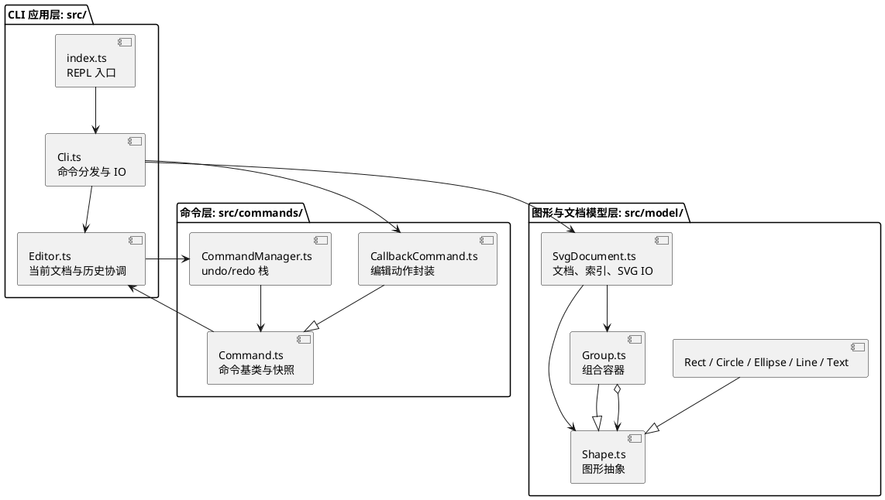

## 架构方案

### 1. 模块划分

本版按实际目录划分为四个模块。`src/index.ts` 是程序入口，不单独作为业务模块；`src/Editor.ts` 是编辑器状态协调类，归入 CLI 应用层。

| 模块（目录/文件） | 主要文件 | 职责 |
|---|---|---|
| CLI 应用层（`src/`） | `index.ts`、`Cli.ts`、`Editor.ts` | `index.ts` 建立终端 REPL；`Cli.ts` 分词、分发命令、验证参数、统一错误反馈，并处理 read/save 文件 IO；`Editor.ts` 持有当前文档和命令历史，提供文档状态检查及快照恢复。 |
| 命令层（`src/commands/`） | `Command.ts`、`CallbackCommand.ts`、`CommandManager.ts` | 将一次编辑封装为 Command，执行前保存文档快照，失败时恢复；管理 undo/redo 栈及文档操作后的历史锁定。 |
| 图形与文档模型层（`src/model/`） | `Shape.ts`、六种具体图形类、`Group.ts`、`SvgDocument.ts` | 定义图形对象、多态操作和容器树；维护唯一 id 索引；提供 SVG 解析和序列化。`SvgDocument` 使用 `fast-xml-parser`。 |
| 项目文档层（`doc/`） | `README.md` | 记录架构方案、开发过程、一致性自查及质量保证手段。 |

### 2. 设计模式的选择

**Command 模式（本项目的必选模式）**：`CallbackCommand` 继承 `Command`，把一次编辑动作封装为可执行、可撤销、可重做的对象；`CommandManager` 按命令对象维护 undo/redo 栈。`Command.run()` 在执行前克隆文档，成功后由管理器入栈；执行失败则恢复快照，因此单条失败命令不会留下部分状态。一次用户编辑对应一个历史单元。显示命令不入栈；`init`、`read`、`save` 和修改画布尺寸会清空历史并锁定撤销/重做，下一次成功编辑解除锁定。

**Composite 模式**：抽象类 `Shape` 定义统一的 `move`、`scale` 和 `clone` 操作；叶子图形实现自身几何变化，`Group` 递归转发移动和缩放，并维护子节点。调用端可对组和叶子使用同一套编辑命令。

**有限的名称分派**：命令名称由 `Cli` 构造器中的 `Map` 分发；图形类型由 `Cli.create()` 中的 `switch` 创建。这两处是当前按名字分派的位置。图形工厂目前只支持六种内置类型；插件注册/provider 插槽留待后续阶段，不在本版实现。

### 3. 依赖方向规则

下表明确规定允许的依赖方向；未列出的方向视为违反规则，应在代码评审或一致性自查中记录并处理。

| 发起依赖的模块 | 可以依赖 | 理由 |
|---|---|---|
| CLI 应用层（`src/index.ts`、`src/Cli.ts`、`src/Editor.ts`） | 命令层、图形与文档模型层、Node.js 文件/终端 API | 应用层负责接收用户输入并协调命令执行、文档操作和 IO。 |
| 命令层（`src/commands/`） | `Editor`、图形与文档模型层 | 命令需要读取/恢复当前文档快照，模型类型用于快照和编辑状态。 |
| 图形与文档模型层（`src/model/`） | 本层内的模型类、`fast-xml-parser` | 模型内部需要协作维护文档树；XML 库只用于 SVG 文本解析。 |
| 项目文档层（`doc/`） | 无运行时代码依赖 | 文档描述实现和约定，不参与程序执行。 |

禁止命令层依赖 CLI 命令解析器，禁止模型层依赖 CLI 或命令层，禁止图形模型反向依赖 `Editor`；这些限制避免领域模型被交互细节和撤销实现污染。`Command` 对 `Editor` 的依赖仅用于文档快照和恢复，属于命令层规则中的明确例外职责。当前未发现模型反向依赖上层的情况。

### 4. 变化点假设

| 未来可能变化的部分 | 发生变化的可能性及影响 | 当前预留或决定不预留的原因 |
|---|---|---|
| 命令集合与命令语法 | 新增命令或调整参数会影响命令注册、帮助文本和参数解析。 | 命令名集中在 `Cli` 的 `Map` 注册点；每个编辑操作通过 `CallbackCommand` 走统一历史路径。当前不拆独立命令插件框架，因为本阶段命令数量有限，抽象会增加维护成本。 |
| 图形类型及图形创建参数 | 未来可能加入 `box` 等复合类型，类型的属性和创建流程可能不同。 | `Shape` 多态接口与 `Group` 组合语义已预留统一操作；当前在 `Cli.create()` 集中处理六种内置类型。本阶段不实现 provider 插槽或 `box`，避免提前承担插件生命周期和参数 schema 的复杂度。 |
| SVG 格式兼容范围 | 外部文件可能包含当前未支持的 SVG 元素、属性或文本结构。 | XML 解析和序列化集中在 `SvgDocument`，便于替换解析器或增加转换策略。当前只支持六种指定图形和基本属性，不预先实现完整 SVG 规范兼容。 |
| undo/redo 的性能与粒度 | 文档规模变大时，全量深拷贝快照会增加内存和执行开销。 | 命令基类集中保存快照，`CommandManager` 集中管理历史；未来可把快照改为命令逆操作或局部变更记录。当前选择全量快照，以简化第一版正确回滚与验证。 |
| CLI 与其他交互界面的共用 | 未来若加入 GUI/API，输入解析和文件路径处理不应成为模型能力的一部分。 | 领域模型与 CLI 已分层；当前读写入口仍由 `Cli` 协调，尚未抽独立应用服务，因为目前只有 CLI 一种交互方式。 |

## 过程记录

本节记录项目从首版实现到当前回归测试的代表性讨论、核验和修正。测试输入、逐例输出和缺陷复现保存在 `test/`，这里概述决策及其结果。

| 阶段 | 讨论或原实现中的问题 | 如何确认 | 修正或结论 |
|---|---|---|---|
| 1. 明确阶段边界并搭建实现 | 作业说明对后续插件类型 `box` 描述很多，容易把它误当成本阶段必做功能；架构也必须满足 Command 模式和容器/叶子统一操作。 | 对照说明中的阶段边界、命令表和 `box` 章节，确认本阶段内置类型仅为 rect、circle、ellipse、line、text、g；检查命令注册和历史管理路径。 | 第一版不实现 `box`，通过 `create` 工厂返回未知类型错误；用 `CallbackCommand`、`Command` 和 `CommandManager` 组织编辑历史，用 `Shape`/`Group` 表达 Composite 操作。 |
| 2. 建立文档树和历史快照 | 读入嵌套 SVG 时，如果容器递归解析子节点的同时又重复登记索引，可能造成 id 重复；失败编辑若只回滚部分字段也可能留下不一致状态。 | 检查 `SvgDocument` 的解析、索引登记和树关系，并回放创建、删除、分组及 undo/redo。 | 将整棵子树的 id 登记集中到 `attach`；解析阶段先建立子树，再由顶层挂接登记。第一版用整份文档快照支持撤销和异常恢复。后续测试也证明需逐个命令核对原子性，不能仅凭快照设计就假定所有失败路径正确。 |
| 3. 补足使用引导 | 初始 CLI 只有单行提示符和命令概要；第一次启动时用户不容易知道如何完成创建、查看和保存的一轮操作。 | 通过实际 REPL 输入 `help`、错误命令和一组基础命令，检查输出是否能引导下一步。 | 增加启动快速开始、分类帮助、`help <command>` 详解、空画布提示及常见错误提示，并通过子进程回放验证。 |
| 4. 按实际目录修订架构说明 | 早期文档提到了并不存在的 `src/cli/` 目录，也将应用层边界写得与代码目录不一致。 | 对照 `src/`、`src/commands/`、`src/model/` 的实际文件及静态 import，逐项检查模块职责和允许的依赖方向。 | 将架构方案改为描述实际目录：CLI 应用层位于 `src/` 根目录；命令和模型分别位于两个子目录。检查生产 TypeScript 源码后未发现违反依赖规则的导入。 |
| 5. 将质量检查变成可重复测试 | 早期质量说明主要依据手工会话；曾记录一次 22 组、7 组失败的临时检查，但没有保存输入和原始输出，因此其他人无法复现，不能作为持续验收证据。 | 对照 `phase_cli_1.md` 将功能拆成可断言场景，并覆盖直接调用、文件往返和真实终端入口。 | 新建 `test/`，保存 fixtures、49 个断言场景、REPL 输入、报告和运行过程；将 `npm test` 接到测试执行器。失败断言保留非零退出，不伪装成预期通过。 |
| 6. 处理 tree 样式遗漏 | 首轮回归中 V02 发现：`create rect r 1 2 3 4 red` 后，`tree` 只显示几何数据，没有显示 `fill`；而 `show` 已能读到属性。这说明树输出格式化函数只拼接了 `geometry()`，忽略样式字典。 | 用 V02 对实际 `tree` 输出做断言，并扩展检查矩形 fill、线条 stroke/stroke-width、容器样式。 | 修改 `draw()`，在几何属性之后追加已设置的 `fill`、`stroke`、`stroke-width`；未设置的属性不输出。V02 复测通过，报告由 40/49 通过提升为 41/49。 |
| 7. 保留仍失败的验收项 | 同一套自动检查暴露了跨父分组、addto 环检查、canvas 参数原子性和 SVG 导入/顺序等问题；正常路径的成功输出并不能说明这些边界行为满足要求。 | 逐项核对报告中的期望值与实际值；对 `addto` 成环场景在发现错误放行后立即终止该用例，避免继续遍历有环结构。 | Q7 已修复；Q1–Q6、Q8、Q9 仍作为失败项保留。当前结果为构建通过、49 个场景 41 个通过和 8 个失败；不宣称整个功能已完整。 |

每次修改后的测试过程和逐例结果以 [test/PROCESS.md](../test/PROCESS.md) 与 [test/results/report.md](../test/results/report.md) 为准。测试在修改前后可能有不同结果，报告记录最近一次运行，过程记录保留最初 40/49 基线及 V02 修复后的变化。

## 一致性自查

### 1. 模块划分

实际目录和文件与架构方案一致：CLI 应用层位于 `src/` 根目录，由 `index.ts`、`Cli.ts` 和 `Editor.ts` 组成；命令层位于 `src/commands/`；图形与文档模型层位于 `src/model/`；项目说明文档位于 `doc/`。源码职责也与模块表和 PlantUML 图相符。CLI 应用层目前直接放在 `src/` 根目录，没有单独的 `src/cli/` 子目录；架构方案已按实际结构说明这一点，因此这是已记录的目录选择，不是未记录的偏差。检查未发现其他目录或职责划分差异，也没有需要补入修订记录的偏差。

### 2. 依赖方向

已抽样检查 `src/` 下全部 TypeScript 文件的静态导入，包括普通 import 和类型导入。CLI 应用层依赖 `src/commands/`、`src/model/` 及 Node.js 的文件/终端 API；命令层依赖 `Editor` 和模型层；模型层只依赖本层模型以及 `fast-xml-parser`；未发现命令层依赖 CLI 命令解析器、模型层依赖 CLI/命令层或模型反向依赖 `Editor` 的情况。`Command` 对 `Editor` 的引用用于保存和恢复文档快照，符合方案为命令层明确列出的允许依赖。

检查范围不包含 `node_modules/` 中第三方包源码；`dist/` 是由 `src/` 编译生成的产物，不作为独立架构模块检查。结论：本次检查未发现违反依赖方向规则的项目源码依赖。

## 质量保证手段

### 1. 如何确认功能是否完整

以 `phase_cli_1.md` 为验收依据，按文档管理、六种内置图形、编辑操作、容器层级、显示、撤销重做和异常处理逐项核对。验证时不只看命令是否输出成功，还比较执行前后的几何数据、父子关系、同级顺序和历史状态；对失败命令检查状态是否保留，对文件读写检查 SVG 是否有效及读回后是否保留原数据。本阶段不要求实现的 `box` 不计为缺失功能，但需要验证创建它会报告未知类型。

已将验证保存为独立的 `test/` 文件夹，并接入 `npm test`。该命令先按 `tsconfig.json` 严格构建，再执行 `test/cases.cjs` 中的 49 个独立场景，使用 Node.js 的 `assert/strict` 核对编译后的 `Cli.runLine()` 和 `SvgDocument`；另外启动真实 `dist/index.js` 子进程，回放固定的正常及错误命令脚本。每例使用独立会话，文件测试使用独立临时目录，运行结束后清理。

| 需求范围 | 样例编号 | 验证内容与判断依据 |
|---|---|---|
| 文档和输入 | D01–D04、E01–E03 | 默认/浮点尺寸、中文/空格/空文本、帮助、参数格式、IO 失败及状态原子性。 |
| 六种图形和编辑 | S01–S12、G01 | 每种类型的创建、move/scale 数值、in、样式默认值、属性白名单、递归变换、唯一和非空 id。 |
| 层级与顺序 | G02–G11 | 同父/跨父分组、解组、子树删除、迁移环检查及 front/back，核对父子关系和原顺序。 |
| 撤销重做 | H01–H05 及 G 系列 | 一条编辑一个历史单元、快照隔离、redo 分支、失败编辑保留历史以及 IO 后锁定。 |
| SVG 读写和显示 | F01–F09、V01–V02 | 有效 XML、转义、基本往返、补 id、重复 id、绘制顺序、导入后再保存、损坏 XML 及 tree/show 的几何和 fill/stroke/stroke-width。 |
| 实际交互入口 | I01–I02 | 回放原说明 6.1 双节点流程图和错误命令脚本，核对进程退出码、终端反馈及导出 SVG。 |

初始基线为 49 个场景通过 40 个、失败 9 个。随后根据 V02 的失败反馈修改 tree 输出，在几何信息后显示已设置的 `fill`、`stroke` 和 `stroke-width`，未设置的样式不显示。修改后的最新结果：**严格构建通过；49 个场景中 41 个通过、8 个失败，`npm test` 退出码为 1。** 剩余失败场景使用正常验收断言，未跳过，也未当作“预期失败”转为通过。

最新待修复项为 Q1 跨父分组被拒绝、Q2 祖先迁入后代未被拒绝、Q3 迁入当前父容器被误拒绝、Q4 非法 canvas 参数造成部分修改、Q5 导入后保存出现重复 XML 属性、Q6 导入改变绘制顺序、Q8 损坏 XML 被接受以及 Q9 空 id 被接受。Q7 已修复并由 V02 回归测试通过。全部最小复现、期望与实际表现保留在 [test/PROCESS.md](../test/PROCESS.md)。

因此，当前证据能确认已通过场景中的行为，**尚不能确认最终功能完整**。完成验收需要修复上述问题、全量重测通过，再结合人工 SVG 视觉检查。未进行浏览器截图验收、大文档性能/内存压力测试、完整 SVG 标准兼容验证、代码覆盖率统计或跨操作系统复验，不将这些内容计为已通过。

### 2. 对代码质量有信心的依据与边界

| 质量保证手段 | 已有证据及其作用 |
|---|---|
| 严格类型构建 | `tsconfig.json` 开启 `strict`，本次编译通过，编译命令和退出码见 `test/results/build.log`。源码仍存在 `any` 和动态字段访问，因此不以编译通过代替功能验收。 |
| 可重复的行为断言 | `test/cases.cjs` 保存需求依据、输入和独立预期值；对关键坐标、层级、历史与错误状态进行断言，失败时非零退出，便于后续修复和防止回归。 |
| 架构与依赖检查 | A01 扫描当前全部 14 个生产 TypeScript 文件的普通及类型导入，结果通过；模型未反向依赖 CLI、命令层或 Editor。静态字符串导入检查不替代未来动态加载场景的人工评审。 |
| 真实入口与文件验证 | I01/I02 从 stdin 回放实际 REPL；保存输出、XML 校验和读回数据断言共同验证执行链。生成的流程图可供人工预览，但未把未执行的视觉检查记为通过。 |
| 可追溯的验证记录 | JSON 保留各例命令、实际输出、错误断言、环境、Git HEAD 和生产源码 SHA-256；记录工作区源码哈希，避免仅用提交号描述含未提交修改的被测版本。关键注释及架构文档帮助复核。 |
| 修改检查与版本复现 | `git diff --check` 检查空白格式；`package-lock.json` 提供依赖版本锁定，可用 `npm ci` 重复安装。未声称已在其他机器独立复验。 |

这些手段为类型、架构以及已覆盖行为提供证据。当前已具备持久化回归测试，tree 样式显示已通过回归检查，但仍有 8 个失败场景，因此不能对“最终全部功能正确”给出足够信心。质量完成标准是：剩余已知缺陷关闭、构建与全部回归检查通过，并完成 SVG 人工预览和最终复核。

### 3. 测试材料的保存与复现

| 材料 | 保存位置 |
|---|---|
| 运行方法与需求对应关系 | [test/README.md](../test/README.md) |
| 自动化场景与执行器 | `test/cases.cjs`、`test/run.cjs` |
| 固定 SVG 和 CLI 输入样例 | `test/fixtures/` |
| 测试过程、最小复现及待修复项 | [test/PROCESS.md](../test/PROCESS.md) |
| 本次逐项结果及失败原因 | [test/results/report.md](../test/results/report.md) |
| 输入/输出、断言及版本指纹 | `test/results/report.json` |
| 编译、实际 REPL 正常/错误回放日志 | `test/results/build.log`、`test/results/repl.log`、`test/results/errors.log` |
| 实际导出的流程图 SVG | `test/results/flowchart.svg` |

在项目根目录执行 `npm test` 会重新构建、测试并更新上述结果文件；使用 `npm run build` 可以只做编译检查。本次新增的 `test/` 是测试辅助目录，单向依赖生产代码，不改变既有生产模块职责。

